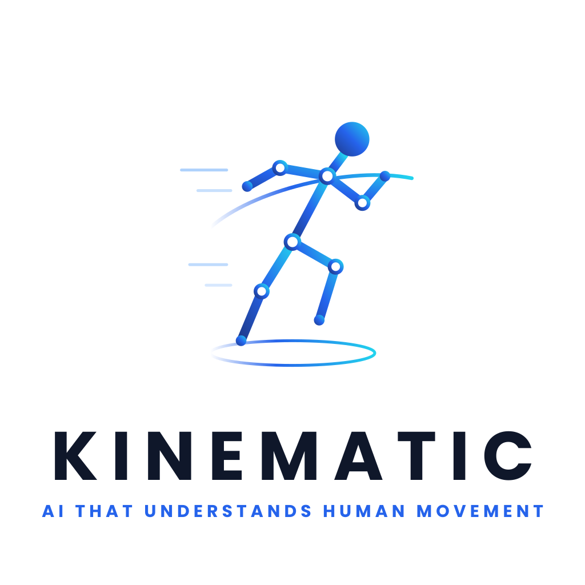

<p align="center"></p>

# Kinematic

AI personal trainer in the browser. Pick an exercise, put your phone or laptop 2–3 m away,
and Kinematic counts your reps, checks your form and coaches you out loud. Everything runs
on your device: your video is never uploaded.

Live: https://kinematic-one.vercel.app

Features:
- 18 exercises: 15 counted (reps) + 3 timed holds (plank, side plank, wall sit)
- Live form feedback and a form score for every rep; left/right counting for lunges, curls and mountain climbers
- Smart judging: reps only count in the right body position; camera glitches and hidden limbs are ignored
- Voice coach in English and Hindi (whole app switches language)
- Sets & reps with a rest timer (±10 s), or free workout with a count-up rest clock
- 3-2-1 countdown, or start automatically when you're in position
- Routines with 6 levels (absolute beginner → athlete): deeper reps and stricter form as the level goes up, plus routines recommended for your level
- "How to do it" demo for every exercise
- Record session: video with skeleton, reps, angles and tips drawn on it (optional sound), downloaded to your device
- Body tracking: weight goal, healthy-pace check, BMI, estimated goal date
- History: streaks, weekly goal, badges, progress charts, personal bests
- Backup / import, CSV export and a PDF workout log
- Built for phones: count and tips on the video, screen stays on, thumb-sized buttons
- Debug panel for tuning (press D on the workout screen, laptop)

See ROADMAP.md for what's planned next.

Exercises, grouped by body part:

| Category | Exercises |
|---|---|
| Legs | Squat, Lunge, Glute bridge, Wall sit (timed) |
| Chest | Push-up, Dips |
| Back | Pull-up, Romanian deadlift |
| Shoulders | Shoulder press, Lateral raise |
| Arms | Bicep curl |
| Core | Crunch, Sit-up, Hanging knee raise, Plank (timed), Side plank (timed) |
| Full body / Cardio | Jumping jacks, Mountain climbers |

## Run it

Needs Node.js 20+.

```bash
npm install
npm run dev
```

Open http://localhost:5173 in Chrome, Edge or Safari and allow camera access.
The first load needs internet (it downloads the MediaPipe pose model, ~5 MB).

Other commands:

```bash
npm test            # unit tests (counting, judging for all exercises, levels, body, history)
npm run typecheck   # TypeScript check
npm run build       # production build into dist/
```

## Folder structure

```
src/
  engine/            the brain: plain TypeScript, no React
    camera.ts          turns on the camera (full 3:4 view on phones)
    pose.ts            MediaPipe wrapper -> 33 body points per frame
    geometry.ts        angle maths, smoothing, "is the body in frame"
    repCounter.ts      generic rep counter (rest -> moving -> active -> rest)
    feedback.ts        keeps tips on screen steady (no flicker)
    drawing.ts         draws the skeleton on the canvas
    voice.ts           voice coach (browser speech, English/Hindi)
    recorder.ts        "Record session" video with overlays
    exercises/         one file per exercise: main angle, thresholds, position check, form rules
      levels.ts          the 6 training levels used by routines
  i18n/              translations (Hindi); English text is the key
  ui/
    screens/           Picker, Setup, Workout, Summary, Routines, History
    body/              body weight goal + tracking
    components/        shared pieces (rep counter, pickers, level picker, recording...)
    demo/              "How to do it" animations
  state/
    workoutSession.ts  sets + rest timer logic
    session.ts         workout summary
    history.ts         saved workouts (localStorage)
    settings.ts        voice, camera, level, language, last plan per exercise
    routines.ts        built-in routines + scaling to a level
    body.ts            weight goal and entries
  styles/            global CSS + variables
tests/              unit tests (engine + state)
```

## Add an exercise

1. Copy `src/engine/exercises/squat.ts` and change the name, `category`, angle, thresholds and checks.
   Categories live in `src/engine/exercises/categories.ts`.
2. Add it to the list in `src/engine/exercises/index.ts`.

## Tuning

Thresholds are first guesses. If reps are missed or double-counted, adjust the
`counter` numbers in that exercise's file.
